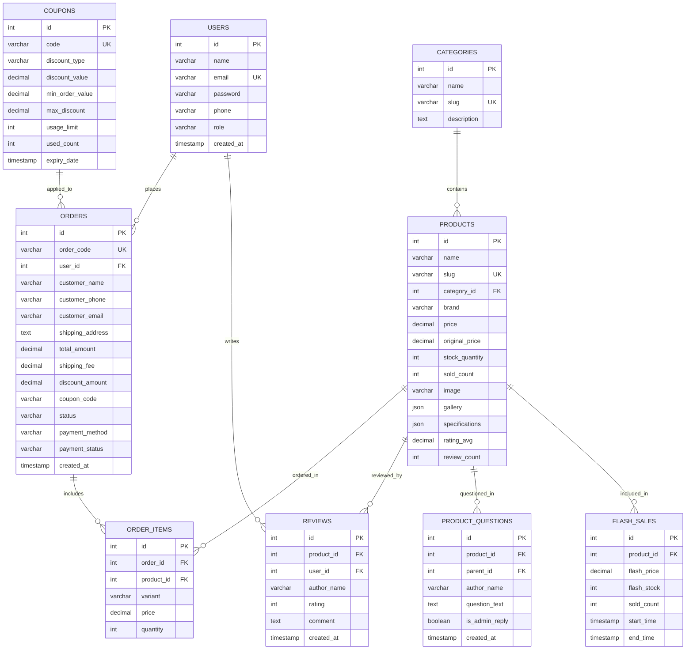

# Đặc Tả REST API & Cơ Chế Lưu Trữ TechStore

> **Dự án**: TechStore - Website Bán Lẻ Công Nghệ  
> **Tài liệu tham chiếu**: [ARCHITECTURE.md](./ARCHITECTURE.md) | [DATA_FLOW.md](./DATA_FLOW.md)

---

## 1. Tổng Quan Về Giao Thức REST API

Tất cả các endpoints trong dự án TechStore đều tuân theo chuẩn RESTful, sử dụng phương thức HTTP (`GET`, `POST`, `PUT`, `DELETE`), định dạng dữ liệu trao đổi qua JSON (`Content-Type: application/json`), và có tiền tố chung là `/api/`.

Các yêu cầu đặc quyền quản trị viên yêu cầu gửi kèm HTTP Header:
```http
x-user-role: admin
```

---

## 2. Danh Mục Chi Tiết Toàn Bộ Endpoints

### 2.1. Nhóm Xác Thực & Tài Khoản (`/api/auth/*`)

#### A. Đăng Ký Tài Khoản Mới
- **Endpoint**: `POST /api/auth/register`
- **Mô tả**: Tạo tài khoản người dùng mới trong cơ sở dữ liệu.
- **Request Body**:
  ```json
  {
    "name": "Nguyễn Văn A",
    "email": "nguyenvana@gmail.com",
    "password": "mypassword123",
    "phone": "0987654321"
  }
  ```
- **Response Success (201 Created)**:
  ```json
  {
    "success": true,
    "message": "Đăng ký tài khoản thành công",
    "user": {
      "id": 5,
      "name": "Nguyễn Văn A",
      "email": "nguyenvana@gmail.com",
      "role": "customer"
    }
  }
  ```
- **Response Error (400 Bad Request)**: Email đã tồn tại hoặc thiếu trường bắt buộc.

#### B. Đăng Nhập Tài Khoản
- **Endpoint**: `POST /api/auth/login`
- **Mô tả**: Kiểm tra email/mật khẩu và trả về thông tin người dùng.
- **Request Body**:
  ```json
  {
    "email": "nguyenvana@gmail.com",
    "password": "mypassword123"
  }
  ```
- **Response Success (200 OK)**:
  ```json
  {
    "success": true,
    "message": "Đăng nhập thành công",
    "user": {
      "id": 5,
      "name": "Nguyễn Văn A",
      "email": "nguyenvana@gmail.com",
      "phone": "0987654321",
      "role": "customer"
    }
  }
  ```

---

### 2.2. Nhóm Danh Mục & Sản Phẩm (`/api/products/*`, `/api/categories`)

#### A. Lấy Danh Sách Danh Mục
- **Endpoint**: `GET /api/categories`
- **Response Success (200 OK)**: Danh sách các danh mục (smartphone, laptop, tablet, smartwatch, audio, gaming-gear).

#### B. Lấy Danh Sách Sản Phẩm (Kèm Tìm Kiếm & Lọc)
- **Endpoint**: `GET /api/products`
- **Query Parameters**:
  - `category` (string, tùy chọn): Slug danh mục (`laptop`, `smartphone`,...).
  - `brand` (string, tùy chọn): Hãng sản xuất (`Apple`, `Asus`, `Samsung`,...).
  - `search` (string, tùy chọn): Từ khóa tìm kiếm theo tên hoặc thông số.
  - `minPrice`, `maxPrice` (number, tùy chọn): Khoảng giá mong muốn.
  - `sort` (string, tùy chọn): Tiêu chí sắp xếp (`price-asc`, `price-desc`, `newest`, `popular`).
  - `page` (number, mặc định `1`): Trang hiện tại.
  - `limit` (number, mặc định `20`): Số lượng sản phẩm mỗi trang.
- **Response Success (200 OK)**:
  ```json
  {
    "success": true,
    "data": [
      {
        "id": 1,
        "name": "iPhone 15 Pro Max 256GB",
        "slug": "iphone-15-pro-max-256gb",
        "category_id": 1,
        "category_slug": "smartphone",
        "brand": "Apple",
        "price": 29490000,
        "original_price": 34990000,
        "image": "https://cdn.viettelstore.vn/...",
        "stock_quantity": 45,
        "sold_count": 128,
        "rating_avg": 4.9,
        "review_count": 42,
        "specifications": {
          "cpu": "Apple A17 Pro",
          "ram": "8GB",
          "rom": "256GB",
          "screen": "6.7 inch Super Retina XDR"
        }
      }
    ],
    "total": 1,
    "page": 1,
    "totalPages": 1
  }
  ```

#### C. Lấy Chi Tiết Sản Phẩm
- **Endpoint**: `GET /api/products/:id`
- **Response Success (200 OK)**: Đối tượng sản phẩm chi tiết kèm danh sách ảnh (gallery) và các tùy chọn màu sắc/dung lượng.

#### D. Thêm Sản Phẩm Mới (Admin Only)
- **Endpoint**: `POST /api/products`
- **Headers**: `x-user-role: admin`
- **Request Body**: Toàn bộ thuộc tính sản phẩm (`name`, `category_id`, `brand`, `price`, `original_price`, `stock_quantity`, `image`, `description`, `specifications`).

#### E. Cập Nhật Sản Phẩm (Admin Only)
- **Endpoint**: `PUT /api/products/:id`
- **Headers**: `x-user-role: admin`

#### F. Xóa Sản Phẩm (Admin Only)
- **Endpoint**: `DELETE /api/products/:id`
- **Headers**: `x-user-role: admin`

---

### 2.3. Nhóm Flash Sale (`/api/flash-sales/*`)

#### A. Lấy Danh Sách Sự Kiện Flash Sale Đang Diễn Ra
- **Endpoint**: `GET /api/flash-sales`
- **Response Success (200 OK)**:
  ```json
  {
    "success": true,
    "data": [
      {
        "id": 1,
        "product_id": 1,
        "name": "iPhone 15 Pro Max 256GB",
        "flash_price": 27990000,
        "original_price": 34990000,
        "stock_quantity": 20,
        "sold_count": 14,
        "start_time": "2026-10-12T00:00:00Z",
        "end_time": "2026-10-12T23:59:59Z"
      }
    ]
  }
  ```

---

### 2.4. Nhóm Mã Giảm Giá (`/api/coupons/*`)

#### A. Xác Thực Mã Giảm Giá (Validate Coupon)
- **Endpoint**: `POST /api/coupons/validate`
- **Request Body**:
  ```json
  {
    "code": "TECH10",
    "total_amount": 15000000
  }
  ```
- **Response Success (200 OK)**:
  ```json
  {
    "success": true,
    "coupon": {
      "code": "TECH10",
      "discount_type": "percentage",
      "discount_value": 10,
      "max_discount": 500000,
      "discount_amount": 500000,
      "description": "Giảm 10% tối đa 500.000đ cho đơn từ 2.000.000đ"
    }
  }
  ```

---

### 2.5. Nhóm Đơn Hàng (`/api/orders/*`)

#### A. Tạo Đơn Hàng Mới (Checkout)
- **Endpoint**: `POST /api/orders`
- **Request Body**:
  ```json
  {
    "customer_name": "Trần Thị B",
    "customer_phone": "0912345678",
    "customer_email": "tranthib@gmail.com",
    "shipping_address": "Số 123 Đường Cầu Giấy, Hà Nội",
    "note": "Giao giờ hành chính",
    "payment_method": "cod",
    "coupon_code": "TECH10",
    "shipping_fee": 30000,
    "items": [
      {
        "product_id": 1,
        "variant": "Titan Tự Nhiên - 256GB",
        "price": 29490000,
        "quantity": 1
      }
    ]
  }
  ```
- **Response Success (201 Created)**:
  ```json
  {
    "success": true,
    "message": "Đặt hàng thành công",
    "order": {
      "id": 1024,
      "order_code": "ORD-1024",
      "total_amount": 29020000,
      "status": "pending",
      "payment_status": "unpaid"
    }
  }
  ```

#### B. Tra Cứu Đơn Hàng Đa Năng
- **Endpoint**: `GET /api/orders/track`
- **Query Parameter**: `query` (Mã đơn hàng `#ORD-1024`, SĐT `0912345678`, hoặc Email).
- **Response Success (200 OK)**: Danh sách các đơn hàng phù hợp kèm danh sách sản phẩm (`order_items`).

#### C. Lấy Đơn Hàng Theo Tài Khoản Đăng Nhập
- **Endpoint**: `GET /api/orders/user/:userId`
- **Response Success (200 OK)**: Toàn bộ lịch sử mua hàng của tài khoản.

#### D. Cập Nhật Trạng Thái Đơn Hàng (Admin Only)
- **Endpoint**: `PUT /api/orders/:id/status`
- **Headers**: `x-user-role: admin`
- **Request Body**:
  ```json
  {
    "status": "confirmed"
  }
  ```
  *(Các trạng thái hợp lệ: `pending`, `confirmed`, `shipping`, `completed`, `cancelled`)*.

---

### 2.6. Nhóm Thanh Toán Mô Phỏng (`/api/payment/*`)

#### A. Khởi Tạo Giao Dịch Thanh Toán
- **Endpoint**: `POST /api/payment/create-intent`
- **Request Body**: `{ "order_id": 1024, "method": "vnpay" }`
- **Response**: Trả về thông tin phiên thanh toán và kích hoạt gửi mã OTP mô phỏng.

#### B. Xác Thực Mã OTP Thanh Toán
- **Endpoint**: `POST /api/payment/verify`
- **Request Body**:
  ```json
  {
    "order_id": 1024,
    "otp": "123456"
  }
  ```
- **Response Success (200 OK)**:
  ```json
  {
    "success": true,
    "message": "Giao dịch thanh toán thành công!",
    "transaction_id": "TXN_987654321"
  }
  ```

---

### 2.7. Nhóm Đánh Giá & Hỏi Đáp (`/api/reviews/*`, `/api/products/:id/questions`)

- `GET /api/reviews/product/:id`: Lấy danh sách đánh giá của sản phẩm.
- `POST /api/reviews`: Gửi đánh giá mới (sao 1-5, bình luận).
- `GET /api/products/:id/review-permission`: Kiểm tra khách hàng đã mua sản phẩm này chưa để cấp quyền đánh giá.
- `GET /api/products/:id/questions`: Lấy danh sách câu hỏi & câu trả lời (Q&A).
- `POST /api/products/:id/questions`: Gửi câu hỏi thắc mắc mới.

---

### 2.8. Nhóm Thống Kê Dashboard (`/api/stats`)
- **Endpoint**: `GET /api/stats`
- **Headers**: `x-user-role: admin`
- **Response Success (200 OK)**:
  ```json
  {
    "success": true,
    "data": {
      "total_revenue": 1425800000,
      "total_orders": 86,
      "total_products": 48,
      "pending_orders": 12
    }
  }
  ```

---

## 3. Lược Đồ Cơ Sở Dữ Liệu MySQL (9 Bảng Dữ Liệu)



---

## 4. Cấu Trúc Bộ Nhớ Cục Bộ (Browser LocalStorage)

Hệ thống sử dụng 3 khóa chính trên `localStorage` của trình duyệt:

### 4.1. Khóa `techstore_cart_v1`
Lưu trữ danh sách các món hàng hiện có trong giỏ hàng:
```json
[
  {
    "cart_key": "1_Titan Tu Nhien_256GB",
    "id": 1,
    "name": "iPhone 15 Pro Max",
    "image": "https://cdn.viettelstore.vn/...",
    "variant": "Titan Tự Nhiên - 256GB",
    "price": 29490000,
    "original_price": 34990000,
    "quantity": 2,
    "max_stock": 45
  }
]
```

### 4.2. Khóa `techstore_applied_coupon`
Lưu trữ mã giảm giá đang được kích hoạt:
```json
{
  "code": "TECH10",
  "discount_type": "percentage",
  "discount_value": 10,
  "max_discount": 500000,
  "discount_amount": 500000
}
```

### 4.3. Khóa `techstore_user`
Lưu trữ phiên đăng nhập hiện tại của người dùng:
```json
{
  "id": 5,
  "name": "Nguyễn Văn A",
  "email": "nguyenvana@gmail.com",
  "phone": "0987654321",
  "role": "customer"
}
```
*(Nếu là quản trị viên, trường `role` sẽ có giá trị là `"admin"`)*.
