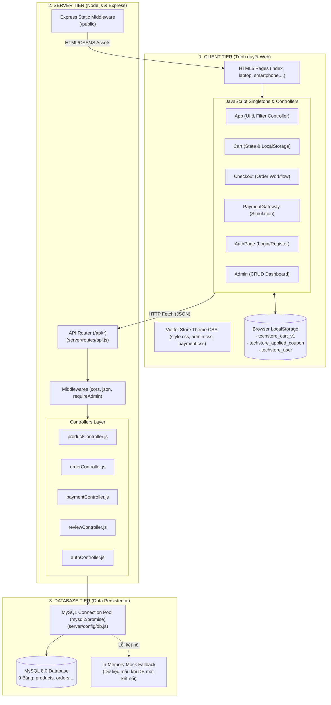

# Kiến Trúc Hệ Thống TechStore

> **Dự án**: TechStore - Website Bán Lẻ Công Nghệ  
> **Tài liệu tham chiếu**: [PROJECT_OVERVIEW.md](./PROJECT_OVERVIEW.md) | [DATA_FLOW.md](./DATA_FLOW.md) | [API_AND_STORAGE.md](./API_AND_STORAGE.md)

---

## 1. Kiến Trúc Tổng Thể (3-Tier Architecture)

Hệ thống TechStore được thiết kế theo mô hình kiến trúc 3 tầng (3-Tier Client-Server-Database Architecture), kết hợp giữa kiến trúc ứng dụng đa trang (Multi-Page Application - MPA) và các thành phần giao diện động (Dynamic SPA-like Components):



---

## 2. Phân Tích Chi Tiết Từng Tầng

### 2.1. Tầng Giao Diện (Client Tier)

#### A. Kiến Trúc Trang (Multi-Page Layout)
Thay vì sử dụng một trang duy nhất (Single-Page Application) hoàn toàn, TechStore sử dụng kiến trúc **MPA có tổ chức**:
- Mỗi danh mục sản phẩm lớn được phân bổ một trang riêng biệt: `smartphone.html`, `laptop.html`, `tablet.html`, `smartwatch.html`, `audio.html`, `gaming-gear.html`.
- Định danh danh mục được gắn trực tiếp trên thẻ `<body>` thông qua thuộc tính `data-category="laptop"`.
- `index.html` đóng vai trò trang chủ tổng hợp (`data-category` để trống), hiển thị Hero Banner Slider và các khối sản phẩm nổi bật của từng nhóm ngành.

#### B. Mô Hình Module Dạng Singleton
Toàn bộ mã JavaScript được tổ chức thành các đối tượng Singleton có không gian tên độc lập:
1. **`App`** (`public/js/app.js`): Điều phối toàn bộ hoạt động giao diện, nhận diện trang hiện tại qua `document.body.dataset.category`, gắn bộ lắng nghe sự kiện, quản lý bộ lọc accordion, thanh tìm kiếm live search, modal chi tiết sản phẩm, hệ thống đánh giá/hỏi đáp và widget nổi (Back-to-top, Tra cứu đơn hàng).
2. **`Cart`** (`public/js/cart.js`): Quản lý trạng thái giỏ hàng theo mô hình **Reactive State**. Bất kỳ thao tác thêm, bớt, xóa sản phẩm hay áp mã giảm giá đều tự động tính toán lại tổng tiền, lưu vào `localStorage` và kích hoạt hàm callback `Cart.onChange()` để các thành phần UI (badge số lượng trên header, modal giỏ hàng, modal thanh toán) tự động cập nhật mà không cần tải lại trang.
3. **`Checkout`** (`public/js/checkout.js`): Điều hướng quy trình điền thông tin giao hàng, validation form, tính toán phí vận chuyển và tương tác với API tạo đơn hàng.
4. **`PaymentGateway`** (`public/js/payment-gateway.js`): Quản lý vòng đời modal thanh toán trực tuyến mô phỏng, xử lý việc sinh mã QR, form nhập thẻ tín dụng, đếm ngược mã OTP và gửi yêu cầu xác thực sang máy chủ.
5. **`AuthPage`** (`public/js/auth.js`): Quản lý luồng đăng nhập, đăng ký và điều hướng hash `#login` / `#register`.
6. **`Admin`** (`public/js/admin.js`): Điều phối bảng điều khiển quản trị viên, tải thống kê, bảng danh sách đơn hàng/sản phẩm và xử lý các thao tác CRUD.

---

### 2.2. Tầng Máy Chủ (Server Tier)

#### A. Khởi Động & Cấu Hình (`server/server.js`)
- Ứng dụng khởi chạy trên cổng xác định bởi `process.env.PORT` (mặc định là `3000`).
- Sử dụng middleware `cors()` để hỗ trợ gọi API linh hoạt.
- Sử dụng middleware `express.json()` và `express.urlencoded()` để giải mã payload HTTP.
- Khởi tạo kết nối cơ sở dữ liệu ngay khi khởi động thông qua `db.init()`.
- Phục vụ tài nguyên tĩnh từ thư mục `public/` với tùy chọn `{ extensions: ['html'] }` giúp người dùng có thể truy cập URL đẹp (ví dụ: `/laptop` thay vì bắt buộc phải gõ `/laptop.html`).

#### B. Định Tuyến API Phân Tầng (`server/routes/api.js`)
Mọi yêu cầu dữ liệu đều bắt đầu bằng tiền tố `/api/` và được ánh xạ tới các Controller tương ứng:
- `/api/auth/*` -> `authController.js`
- `/api/products/*` -> `productController.js`
- `/api/flash-sales/*` -> `productController.js`
- `/api/categories` -> `productController.js`
- `/api/orders/*` -> `orderController.js`
- `/api/coupons/*` -> `orderController.js`
- `/api/reviews/*` & `/api/products/:id/questions` -> `reviewController.js`
- `/api/payment/*` -> `paymentController.js`
- `/api/stats` -> `orderController.js`

#### C. Middleware Phân Quyền (`requireAdmin`)
Được đặt tại `server/routes/api.js`, kiểm tra header `x-user-role: admin` đối với các thao tác nhạy cảm:
- Thêm/sửa/xóa sản phẩm (`POST`, `PUT`, `DELETE /api/products/*`).
- Thêm/xóa Flash Sale (`POST`, `DELETE /api/flash-sales/*`).
- Cập nhật trạng thái đơn hàng (`PUT /api/orders/:id/status`).
- Lấy số liệu thống kê doanh thu (`GET /api/stats`).

---

### 2.3. Tầng Cơ Sở Dữ Liệu (Database Tier)

#### A. Connection Pooling & Transactions
File `server/config/db.js` khởi tạo một `mysql.createPool()` với cấu hình kết nối tự động tối ưu tài nguyên.
Đặc biệt, nghiệp vụ **Đặt Hàng (`createOrder`)** được thực thi bên trong một **Database Transaction (ACID)**:
1. `connection.beginTransaction()`
2. Kiểm tra tồn kho của từng mặt hàng (`SELECT stock_quantity FROM products WHERE id = ? FOR UPDATE`).
3. Trừ số lượng tồn kho và tăng số lượng đã bán (`UPDATE products SET stock_quantity = stock_quantity - ?, sold_count = sold_count + ?`).
4. Chèn thông tin đơn hàng vào bảng `orders`.
5. Chèn danh sách chi tiết các mặt hàng vào bảng `order_items`.
6. `connection.commit()` (hoặc `connection.rollback()` nếu có bất kỳ lỗi nào xảy ra).

#### B. Khả Năng Dự Phòng Tự Động (In-Memory Mock Fallback)
Khi `db.init()` phát hiện không thể kết nối tới MySQL (sai mật khẩu, chưa bật dịch vụ MySQL,...), cờ `isMockMode = true` được kích hoạt. Lớp Data Access Layer sẽ tự động phục vụ dữ liệu từ các danh sách đối tượng mẫu nằm trong bộ nhớ RAM. Điều này đảm bảo dự án luôn sẵn sàng hiển thị giao diện báo cáo mà không bao giờ bị sập trang trắng.

---

## 3. Sơ Đồ Khởi Tạo Ứng Dụng (Initialization Lifecycle)

```mermaid
sequenceDiagram
    autonumber
    actor User as Người dùng
    participant Browser as Trình duyệt Web
    participant Server as Express Server
    participant DB as MySQL Database

    User->>Browser: Truy cập http://localhost:3000/laptop.html
    Browser->>Server: GET /laptop.html
    Server-->>Browser: Trả về file HTML + liên kết CSS/JS
    Browser->>Browser: Parse DOM & Render Layout tĩnh
    Browser->>Browser: Thực thi cart.js -> Nạp LocalStorage vào Cart.items
    Browser->>Browser: Thực thi app.js -> DOMContentLoaded kích hoạt App.init()
    App.init()->>Browser: Kiểm tra document.body.dataset.category ("laptop")
    App.init()->>Browser: Khởi tạo Slider, Accordion Filter, Floating Widgets
    App.init()->>Server: GET /api/products?category=laptop
    Server->>DB: SELECT * FROM products WHERE category_id = ...
    DB-->>Server: Trả về danh sách sản phẩm
    Server-->>App.init(): JSON Response (products array)
    App.init()->>Browser: Render danh sách sản phẩm vào #product-grid
    Browser-->>User: Giao diện hoàn thiện và sẵn sàng tương tác
```

---

## 4. Các Nguyên Tắc Thiết Kế Cốt Lõi (Design Principles)

1. **Không phụ thuộc thư viện nặng (Zero-Framework Frontend)**: Toàn bộ tương tác client được viết bằng Vanilla JS thuần túy, tối ưu tốc độ tải trang và giảm thiểu dung lượng tài nguyên mạng.
2. **Hướng đối tượng thực tế (Pragmatic OOP)**: Sử dụng các Object Literal dạng Module Pattern / Singleton giúp dễ dàng theo dõi biến phạm vi (scope) và tránh xung đột biến toàn cục (`window.*`).
3. **Phân tách trách nhiệm rõ ràng (Separation of Concerns)**:
   - File HTML chỉ chứa khung xương và các container chứa dữ liệu.
   - File CSS chỉ quản lý visual, layout, màu sắc và animation.
   - File JS chỉ xử lý logic tương tác, gọi API và cập nhật DOM.
   - Thư mục Server chỉ tiếp nhận request, kiểm tra dữ liệu và truy vấn DB.
