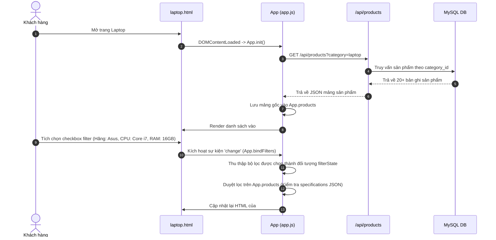
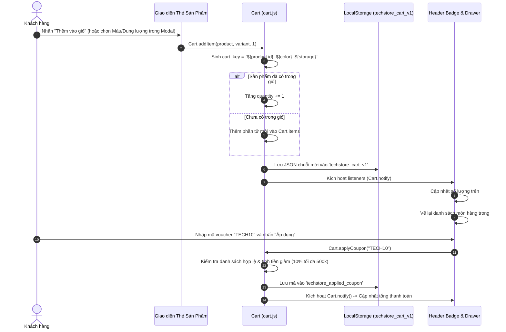
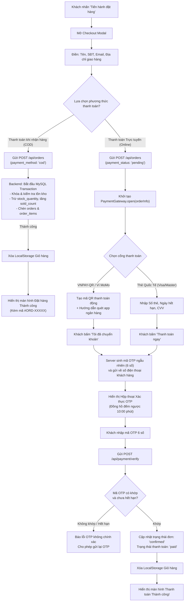
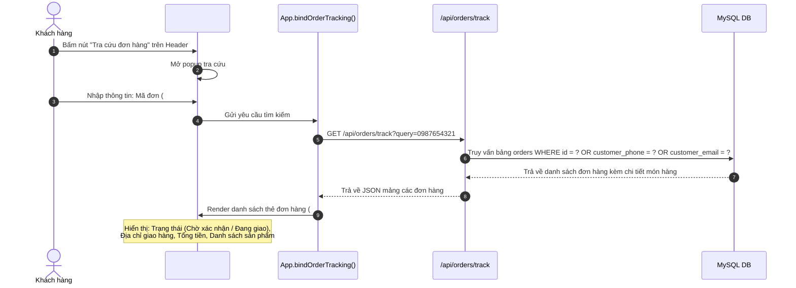
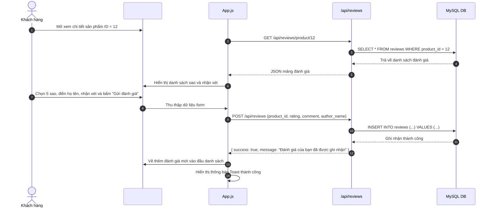
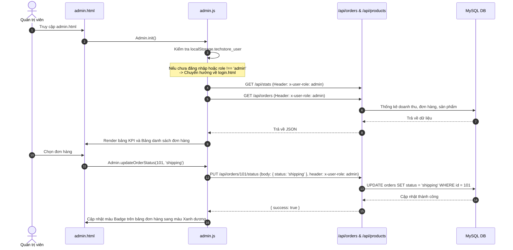

# Luồng Hoạt Động & Dữ Liệu Dự Án TechStore

> **Dự án**: TechStore - Website Bán Lẻ Công Nghệ  
> **Tài liệu tham chiếu**: [ARCHITECTURE.md](./ARCHITECTURE.md) | [JAVASCRIPT_GUIDE.md](./JAVASCRIPT_GUIDE.md) | [API_AND_STORAGE.md](./API_AND_STORAGE.md)

---

## 1. Luồng Duyệt & Lọc Sản Phẩm (Browsing & Multi-Filter Flow)

Khi người dùng duyệt các trang ngành hàng (ví dụ: `laptop.html`), hệ thống xử lý luồng dữ liệu 2 tầng: tầng nạp dữ liệu từ máy chủ và tầng lọc tức thời tại trình duyệt:

---

## 2. Luồng Giỏ Hàng & Mã Giảm Giá (Cart & Coupon Flow)

Giỏ hàng được quản lý bởi `Cart` với cơ chế Reactive State, tự động đồng bộ hóa vào `localStorage`:

---

## 3. Luồng Đặt Hàng & Thanh Toán (Order & Payment Workflow)

Đây là quy trình nghiệp vụ quan trọng nhất của hệ thống, hỗ trợ 2 nhánh thanh toán:

---

## 4. Luồng Tra Cứu Đơn Hàng Đa Kênh (Order Tracking Flow)

TechStore cho phép khách hàng tra cứu tiến độ đơn hàng linh hoạt theo nhiều hình thức:

---

## 5. Luồng Đánh Giá & Hỏi Đáp Sản Phẩm (Reviews & Q&A Flow)

---

## 6. Luồng Quản Trị Viên (Admin Operations Flow)

Bảng điều khiển quản trị viên (`admin.html`) tương tác với các API có kiểm soát quyền truy cập:

