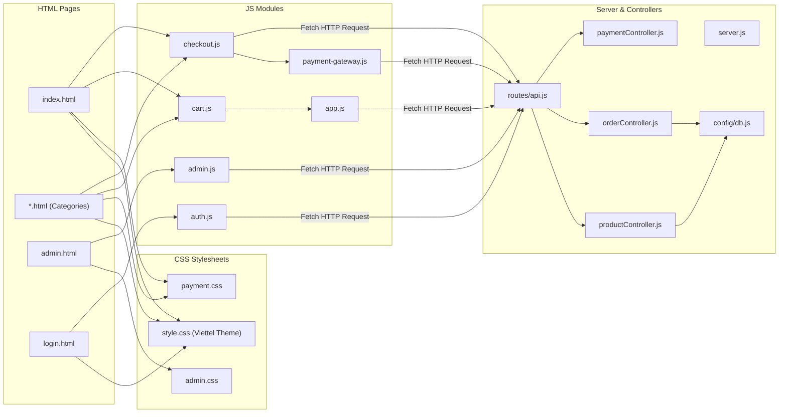

# Cấu Trúc Thư Mục & File Dự Án TechStore

> **Dự án**: TechStore - Website Bán Lẻ Công Nghệ  
> **Tài liệu tham chiếu**: [PROJECT_OVERVIEW.md](./PROJECT_OVERVIEW.md) | [ARCHITECTURE.md](./ARCHITECTURE.md)

---

## 1. Sơ Đồ Cây Thư Mục Thực Tế

Dưới đây là cấu trúc thư mục chi tiết của dự án TechStore (đã loại bỏ thư mục `node_modules` và thư mục `.git` để tập trung vào mã nguồn cốt lõi):

```text
DO_AN_CO_SO_NGANH/
├── .env                          # Biến môi trường cục bộ (Port, cấu hình MySQL)
├── .env.example                  # File mẫu cấu hình môi trường
├── .gitignore                    # Danh sách file/thư mục bỏ qua khi commit Git
├── package.json                  # Khai báo metadata dự án, script và dependencies
├── package-lock.json             # Khóa phiên bản chính xác của các npm packages
├── README.md                     # Hướng dẫn khởi chạy dự án cấp cao
├── seed2.sql                     # File SQL seed dữ liệu mẫu cấp root (sao lưu)
│
├── database/                     # Thư mục mã nguồn cơ sở dữ liệu
│   ├── schema.sql                # Khởi tạo 9 bảng dữ liệu quan hệ (DDL)
│   └── seed2.sql                 # Dữ liệu mẫu ban đầu: categories, products, coupons
│
├── docs/                         # Toàn bộ hệ thống tài liệu kỹ thuật của dự án
│   ├── README.md                 # Mục lục và hướng dẫn tra cứu tài liệu
│   ├── PROJECT_OVERVIEW.md       # Tổng quan dự án, công nghệ, thiết lập
│   ├── ARCHITECTURE.md           # Kiến trúc 3 tầng và vòng đời ứng dụng
│   ├── FILE_STRUCTURE.md         # File này: Sơ đồ và vai trò từng file
│   ├── FEATURES.md               # Ma trận tính năng và trạng thái triển khai
│   ├── DATA_FLOW.md              # Sơ đồ luồng dữ liệu mua hàng và quản trị
│   ├── HTML_GUIDE.md             # Hướng dẫn chi tiết 9 trang HTML
│   ├── CSS_GUIDE.md              # Phân tích hệ thống CSS Viettel Store Theme
│   ├── JAVASCRIPT_GUIDE.md       # Kiến trúc JavaScript và quản lý sự kiện
│   ├── API_AND_STORAGE.md        # Đặc tả REST API, MySQL Schema và LocalStorage
│   ├── DEVELOPMENT_GUIDE.md      # Quy chuẩn và quy trình mở rộng dự án
│   ├── TROUBLESHOOTING.md        # Chẩn đoán lỗi và cách khắc phục
│   ├── TECH_DEBT.md              # Nợ kỹ thuật và kế hoạch tối ưu hóa
│   ├── DOCUMENTATION_RULES.md    # Quy tắc cập nhật và bảo trì tài liệu
│   └── modules/                  # Tài liệu chi tiết từng module JavaScript
│       ├── README.md             # Tổng quan thư mục modules
│       ├── app.md                # Module app.js (UI Controller)
│       ├── cart.md               # Module cart.js (Cart State)
│       ├── checkout.md           # Module checkout.js (Checkout Flow)
│       ├── payment-gateway.md    # Module payment-gateway.js (Cổng thanh toán)
│       ├── auth.md               # Module auth.js (Xác thực người dùng)
│       └── admin.md              # Module admin.js (Quản trị CRUD)
│
├── public/                       # Mã nguồn Client-Side (Phục vụ tĩnh bởi Express)
│   ├── index.html                # Trang chủ tổng hợp (Hero Banner, Flash Sale, Showcases)
│   ├── smartphone.html           # Trang ngành hàng Điện thoại thông minh
│   ├── laptop.html               # Trang ngành hàng Máy tính xách tay
│   ├── tablet.html               # Trang ngành hàng Máy tính bảng
│   ├── smartwatch.html           # Trang ngành hàng Đồng hồ thông minh
│   ├── audio.html                # Trang ngành hàng Thiết bị âm thanh
│   ├── gaming-gear.html          # Trang ngành hàng Phụ kiện Gaming
│   ├── login.html                # Trang Đăng nhập & Đăng ký tài khoản
│   ├── admin.html                # Bảng điều khiển Quản trị viên (Dashboard)
│   │
│   ├── css/                      # Các file định kiểu giao diện (Vanilla CSS)
│   │   ├── style.css             # Stylesheet chính (Viettel Store Theme, layout, card, filter)
│   │   ├── admin.css             # Định kiểu riêng cho trang quản trị Admin
│   │   └── payment.css           # Định kiểu cho modal cổng thanh toán mô phỏng
│   │
│   └── js/                       # Các module xử lý logic JavaScript (Vanilla ES6+)
│       ├── app.js                # Bộ điều phối giao diện, accordion filter, live search, review
│       ├── cart.js               # Service quản lý giỏ hàng Reactive & LocalStorage
│       ├── checkout.js           # Điều phối luồng đặt hàng và tính toán đơn giá
│       ├── payment-gateway.js    # Cổng thanh toán mô phỏng (VNPAY, MoMo, Visa OTP)
│       ├── auth.js               # Xử lý form đăng nhập / đăng ký phía client
│       └── admin.js              # Logic CRUD bảng điều khiển quản trị viên
│
└── server/                       # Mã nguồn Server-Side (Node.js & Express)
    ├── server.js                 # Điểm khởi chạy (Entry Point) của ứng dụng Express
    ├── config/
    │   └── db.js                 # Kết nối MySQL Pool, Transaction và Mock Fallback Layer
    ├── controllers/              # Tầng xử lý nghiệp vụ (Business Logic)
    │   ├── productController.js  # Lấy danh sách, chi tiết, filter, thêm/sửa sản phẩm
    │   ├── orderController.js    # Tạo đơn, tra cứu đơn, coupon, thống kê doanh thu
    │   ├── paymentController.js  # Khởi tạo giao dịch và xác thực mã OTP thanh toán
    │   ├── reviewController.js   # Đánh giá 5 sao và bình luận hỏi đáp (Q&A)
    │   └── authController.js     # Đăng nhập và đăng ký tài khoản người dùng
    └── routes/
        └── api.js                # Định tuyến toàn bộ REST API và middleware phân quyền
```

---

## 2. Bảng Mô Tả Vai Trò Chi Tiết Từng File

### 2.1. Thư Mục Gốc & Cấu Hình
| Tên File | Vai trò | Phân loại |
| :--- | :--- | :--- |
| `package.json` | Khai báo các thư viện phụ thuộc (`express`, `mysql2`, `dotenv`, `cors`) và lệnh chạy `npm start`. | Cấu hình dự án |
| `.env` / `.env.example` | Lưu thông tin cổng mạng (`PORT`) và thông tin kết nối cơ sở dữ liệu MySQL (`DB_*`). | Cấu hình môi trường |
| `README.md` | Hướng dẫn nhanh cách cài đặt và chạy ứng dụng cho người mới tiếp cận repository. | Tài liệu gốc |

---

### 2.2. Thư Mục Cơ Sở Dữ Liệu (`database/`)
| Tên File | Vai trò | Phân loại |
| :--- | :--- | :--- |
| `database/schema.sql` | Khởi tạo cấu trúc bảng: `categories`, `products`, `orders`, `order_items`, `reviews`, `product_questions`, `coupons`, `users`, `flash_sales`. Khai báo khóa chính, khóa ngoại và ràng buộc toàn vẹn. | Mã nguồn DDL |
| `database/seed2.sql` | Chứa dữ liệu mẫu toàn diện: danh mục, sản phẩm chân thực kèm thông số phần cứng, voucher giảm giá và sự kiện flash sale. | Mã nguồn DML |

---

### 2.3. Thư Mục Giao Diện Phía Khách Hàng (`public/`)
| Tên File | Vai trò | Phụ thuộc chính |
| :--- | :--- | :--- |
| `public/index.html` | Trang chủ chính: Khối banner trượt, đếm ngược Flash Sale, khối danh mục tròn, và showcase sản phẩm theo ngành hàng. | `style.css`, `cart.js`, `app.js`, `checkout.js`, `payment-gateway.js` |
| `public/smartphone.html` | Trang danh mục Điện thoại: Chứa bộ lọc thuộc tính hãng, giá, RAM, ROM, màn hình. | Như trên (`data-category="smartphone"`) |
| `public/laptop.html` | Trang danh mục Laptop: Chứa bộ lọc CPU, Card đồ họa, RAM, Ổ cứng, Kích thước màn hình. | Như trên (`data-category="laptop"`) |
| `public/tablet.html` | Trang danh mục Máy tính bảng: Chứa bộ lọc hãng, giá, kích thước màn hình, kết nối. | Như trên (`data-category="tablet"`) |
| `public/smartwatch.html` | Trang danh mục Đồng hồ thông minh: Lọc kiểu dáng, tính năng sức khỏe, thời lượng pin. | Như trên (`data-category="smartwatch"`) |
| `public/audio.html` | Trang danh mục Âm thanh: Lọc tai nghe chụp tai, in-ear, loa bluetooth, chống ồn. | Như trên (`data-category="audio"`) |
| `public/gaming-gear.html` | Trang danh mục Gaming Gear: Lọc bàn phím cơ, chuột gaming, tai nghe gaming. | Như trên (`data-category="gaming-gear"`) |
| `public/login.html` | Trang xác thực người dùng: Chuyển đổi giữa 2 tab Đăng nhập và Đăng ký. | `style.css`, `auth.js` |
| `public/admin.html` | Trang quản trị viên: Quản lý danh sách đơn hàng, quản lý sản phẩm và Flash Sale. | `admin.css`, `admin.js` |

---

### 2.4. Thư Mục Định Kiểu Giao Diện (`public/css/`)
| Tên File | Vai trò | Quy ước sử dụng |
| :--- | :--- | :--- |
| `public/css/style.css` | Stylesheet chính (hơn 4200 dòng): Thiết lập bộ biến màu sắc Viettel Store (đỏ `#ee0033`), typography, thanh header, footer, card sản phẩm, sidebar filter accordion, drawer giỏ hàng, modal chi tiết và responsive breakpoints. | Dùng chung cho toàn bộ các trang người dùng |
| `public/css/admin.css` | Định kiểu giao diện trang quản trị: Bố cục sidebar điều hướng, header admin, thẻ thống kê (kpi cards), bảng dữ liệu (data tables), badge trạng thái và form modal. | Chỉ nạp trên `admin.html` |
| `public/css/payment.css` | Định kiểu cho modal cổng thanh toán trực tuyến mô phỏng: Tab chọn phương thức, khung hiển thị mã QR VNPAY/MoMo, form thẻ ngân hàng và hộp đếm ngược OTP. | Nạp trên các trang có quy trình thanh toán |

---

### 2.5. Thư Mục Logic Phía Trình Duyệt (`public/js/`)
| Tên File | Vai trò | Phạm vi ảnh hưởng |
| :--- | :--- | :--- |
| `public/js/app.js` | Module trung tâm (`App`): Xử lý slider, đếm ngược flash sale, lọc thuộc tính accordion, live search, mở modal chi tiết sản phẩm, tải và gửi review, Q&A, tra cứu đơn hàng, widget cuộn trang. | Toàn bộ các trang client |
| `public/js/cart.js` | Service quản lý giỏ hàng (`Cart`): Thêm/bớt mặt hàng, tính tổng tiền, lưu trữ `localStorage`, quản lý mã voucher, kích hoạt callback cập nhật UI. | Tự động nạp trước `app.js` và `checkout.js` |
| `public/js/checkout.js` | Bộ điều phối đặt hàng (`Checkout`): Mở modal thanh toán, validation form khách hàng, tính toán phí giao hàng, gửi API `POST /api/orders`. | Hoạt động phối hợp với `Cart` và `PaymentGateway` |
| `public/js/payment-gateway.js` | Cổng thanh toán mô phỏng (`PaymentGateway`): Tạo giao diện thanh toán VNPAY/MoMo/Thẻ, sinh mã OTP 6 số, đếm ngược 10 phút, gửi verify sang server. | Kích hoạt khi khách chọn thanh toán online |
| `public/js/auth.js` | Module xác thực (`AuthPage`): Xử lý form đăng nhập/đăng ký, lưu phiên đăng nhập vào `localStorage.techstore_user`. | Hoạt động trên `login.html` |
| `public/js/admin.js` | Module quản trị (`Admin`): Gọi API lấy số liệu dashboard, quản lý danh sách đơn hàng, duyệt đơn, CRUD sản phẩm và Flash Sale. | Hoạt động trên `admin.html` |

---

### 2.6. Thư Mục Máy Chủ Backend (`server/`)
| Tên File | Vai trò | Phụ thuộc chính |
| :--- | :--- | :--- |
| `server/server.js` | Entry point của Express server: Cấu hình middleware, nạp API routes, phục vụ file tĩnh và kết nối DB. | `dotenv`, `express`, `cors`, `server/config/db.js`, `server/routes/api.js` |
| `server/config/db.js` | Khởi tạo MySQL Connection Pool, thực hiện các truy vấn phức tạp (Transaction đặt hàng, trừ tồn kho, tra cứu đơn hàng) và hỗ trợ Mock Fallback. | `mysql2/promise` |
| `server/routes/api.js` | Đăng ký các endpoints REST API, gắn middleware `requireAdmin` để kiểm tra phân quyền. | `express.Router`, các Controllers |
| `server/controllers/productController.js` | Xử lý logic truy vấn danh mục, tìm kiếm, lọc thuộc tính sản phẩm và CRUD sản phẩm. | `server/config/db.js` |
| `server/controllers/orderController.js` | Xử lý logic tạo đơn hàng, tra cứu lịch sử mua hàng, xác thực mã giảm giá và thống kê. | `server/config/db.js` |
| `server/controllers/paymentController.js` | Xử lý logic khởi tạo giao dịch thanh toán trực tuyến mô phỏng và xác thực OTP. | In-memory Transaction Map |
| `server/controllers/reviewController.js` | Xử lý kiểm tra điều kiện đánh giá sản phẩm, gửi review và hỏi đáp sản phẩm. | `server/config/db.js` |
| `server/controllers/authController.js` | Xử lý đăng nhập tài khoản và đăng ký tài khoản mới. | `server/config/db.js` |

---

## 3. Bản Đồ Mối Quan Hệ Phụ Thuộc (Dependency Map)


