# Hướng Dẫn & Cấu Trúc HTML Dự Án TechStore

> **Dự án**: TechStore - Website Bán Lẻ Công Nghệ  
> **Tài liệu tham chiếu**: [CSS_GUIDE.md](./CSS_GUIDE.md) | [JAVASCRIPT_GUIDE.md](./JAVASCRIPT_GUIDE.md) | [modules/app.md](./modules/app.md)

---

## 1. Tổng Quan Cấu Trúc HTML Trong Dự Án

Hệ thống giao diện của TechStore bao gồm **9 trang HTML độc lập** phục vụ các mục đích khác nhau trong quy trình thương mại điện tử:
1. `index.html`: Trang chủ tổng hợp giới thiệu thương hiệu và các chương trình ưu đãi lớn.
2. `smartphone.html`: Trang mua sắm chuyên ngành Điện thoại thông minh.
3. `laptop.html`: Trang mua sắm chuyên ngành Máy tính xách tay.
4. `tablet.html`: Trang mua sắm chuyên ngành Máy tính bảng.
5. `smartwatch.html`: Trang mua sắm chuyên ngành Đồng hồ thông minh.
6. `audio.html`: Trang mua sắm chuyên ngành Thiết bị âm thanh.
7. `gaming-gear.html`: Trang mua sắm chuyên ngành Phụ kiện Gaming.
8. `login.html`: Trang xác thực người dùng (Đăng nhập / Đăng ký).
9. `admin.html`: Bảng điều khiển quản trị viên (Quản lý đơn hàng, sản phẩm, Flash Sale).

---

## 2. Khung Xương Chung (Universal Layout) Của Các Trang Người Dùng

Tất cả các trang từ `index.html` đến 6 trang ngành hàng đều chia sẻ một cấu trúc khung xương nhất quán nhằm duy trì nhận diện thương hiệu và trải nghiệm điều hướng liền mạch:

```mermaid
graph TD
    Body["&lt;body data-category='...'&gt;"]
    Header["&lt;header class='site-header'&gt;"]
    Main["&lt;main class='main-content'&gt;"]
    Modals["&lt;!-- Dynamic Modals & Drawers --&gt;"]
    Floating["&lt;!-- Floating Widgets --&gt;"]
    Footer["&lt;footer class='site-footer'&gt;"]
    Scripts["&lt;!-- JavaScript Modules --&gt;"]

    Body --> Header
    Body --> Main
    Body --> Modals
    Body --> Floating
    Body --> Footer
    Body --> Scripts

    Header --> TopBar["Top Bar (Cam kết & Khuyến mãi)"]
    Header --> MainBar["Main Header (Logo, Search, Hotline, Tra cứu đơn, Giỏ hàng, Tài khoản)"]
    Header --> NavMenu["Navigation Menu (Thanh danh mục sản phẩm ngang)"]

    Modals --> M1["#product-modal (Chi tiết sản phẩm, Reviews, Q&A)"]
    Modals --> M2["#cart-modal (Drawer giỏ hàng, Voucher, Tổng tiền)"]
    Modals --> M3["#checkout-modal (Form đặt hàng, Địa chỉ, COD/Online)"]
    Modals --> M4["#order-tracking-modal (Tra cứu đơn hàng)"]

    Floating --> F1["#back-to-top (Nút cuộn đầu trang + Vòng tròn tiến độ SVG)"]
    Floating --> F2[".floating-contact (Nút hotline & Chat hỗ trợ)"]
```



---

## 3. Phân Tích Chi Tiết Từng Khu Vực Giao Diện

### 3.1. Khu Vực Header (`<header class="site-header">`)
- **Logo Thương Hiệu**: Nằm ở góc trái, sử dụng khối văn bản đồ họa mô phỏng logo Viettel Store với biểu tượng công nghệ và dòng chữ **TechStore**.
- **Thanh Tìm Kiếm Live Search (`#search-input`, `#search-results`)**:
  - Thẻ `<input type="text" id="search-input" placeholder="Bạn cần tìm điện thoại, laptop, phụ kiện gì?">`.
  - Hộp gợi ý xổ xuống `<div id="search-results" class="search-dropdown">`: Ban đầu ẩn (`display: none`), được `App.bindSearch()` hiển thị ngay khi người dùng gõ từ 2 ký tự trở lên.
- **Nút Tra Cứu Đơn Hàng (`#track-order-btn`)**: Cho phép khách hàng mở nhanh modal tra cứu tình trạng đơn hàng bằng Mã đơn hàng hoặc Số điện thoại.
- **Nút Giỏ Hàng (`#cart-btn`)**: Chứa thẻ `<span id="cart-count">0</span>` hiển thị số lượng mặt hàng hiện có, tự động cập nhật bởi `Cart.onChange()`.
- **Nút Tài Khoản (`#account-btn`)**: Hiển thị tên người dùng nếu đã đăng nhập (`localStorage.techstore_user`) hoặc chuyển hướng sang `login.html`.
- **Thanh Menu Điều Hướng Ngang (`<nav class="main-nav">`)**: Chứa danh sách các liên kết trực tiếp tới các trang: `index.html`, `smartphone.html`, `laptop.html`, `tablet.html`, `smartwatch.html`, `audio.html`, `gaming-gear.html`. Trang hiện tại được gắn class `.active`.

---

### 3.2. Cấu Trúc Trang Chủ (`index.html`)
Trang chủ không gắn `data-category` trên thẻ `<body>`. Cấu trúc phần `<main>` bao gồm:
1. **Hero Banner Slider (`.hero-slider`)**:
   - Khung hình ảnh banner lớn (`.slide-item`), nút điều hướng trước/sau (`.prev-btn`, `.next-btn`) và các chấm chỉ số (`.slider-dots`).
   - Được điều khiển tự động lướt mỗi 5 giây bởi `App.initHeroSlider()`.
2. **Khối Danh Mục Tròn Nổi Bật (`.category-grid-home`)**:
   - Lưới các icon danh mục hình tròn bo tròn viền đỏ, dẫn hướng nhanh đến từng trang ngành hàng.
3. **Khối Flash Sale Động (`#flash-sale-section`)**:
   - Tiêu đề rực lửa kèm đồng hồ đếm ngược: `<span id="fs-hours">00</span>:<span id="fs-minutes">00</span>:<span id="fs-seconds">00</span>`.
   - Băng chuyền sản phẩm Flash Sale (`#fs-product-slider`) hiển thị thẻ sản phẩm có giá sốc và thanh tiến độ `Đã bán X/Y sản phẩm`.
4. **Khối Sản Phẩm Theo Ngành Hàng (Category Showcases)**:
   - Các khối tiêu đề và danh sách 4-8 sản phẩm tiêu biểu cho từng dòng: Điện thoại hot, Laptop bán chạy, Phụ kiện âm thanh,... kèm nút "Xem tất cả" dẫn tới trang chuyên ngành.

---

### 3.3. Cấu Trúc Các Trang Ngành Hàng (`*.html`)
Trên các trang như `laptop.html`, `smartphone.html`,... thẻ `<body>` được gắn thuộc tính nhận diện:
```html
<body data-category="laptop">
```
Cấu trúc phần `<main>` được chia thành bố cục 2 cột (Flexbox/Grid layout):

```text
+--------------------------------------------------------------------------+
| Breadcrumb: Trang chủ / Laptop                                           |
+--------------------+-----------------------------------------------------+
| SIDEBAR BỘ LỌC     | KHU VỰC SẢN PHẨM (main content)                     |
| (.filter-sidebar)  | Toolbar: Sắp xếp (Giá tăng/giảm, Mới nhất, Bán chạy) |
|                    +-----------------------------------------------------+
| - Accordion Hãng   | Lưới Sản Phẩm (#product-grid)                       |
| - Accordion Giá    | [ Card 1 ]  [ Card 2 ]  [ Card 3 ]  [ Card 4 ]      |
| - Accordion CPU    | [ Card 5 ]  [ Card 6 ]  [ Card 7 ]  [ Card 8 ]      |
| - Accordion RAM    |                                                     |
| - Accordion Ổ cứng +-----------------------------------------------------+
| - Accordion Màn    | Nút Tải Thêm / Phân Trang                           |
+--------------------+-----------------------------------------------------+
```

#### Chi Tiết Bộ Lọc Accordion (`.filter-sidebar`)
Các tiêu chí lọc được nhóm thành các khối Accordion có thể đóng/mở linh hoạt:
```html
<div class="accordion-item active">
  <div class="accordion-header">
    <span>Bộ Vi Xử Lý (CPU)</span>
    <i class="fa-solid fa-chevron-down"></i>
  </div>
  <div class="accordion-content">
    <label class="filter-checkbox">
      <input type="checkbox" name="cpu" value="intel-core-i5"> Intel Core i5
    </label>
    <label class="filter-checkbox">
      <input type="checkbox" name="cpu" value="intel-core-i7"> Intel Core i7
    </label>
    <label class="filter-checkbox">
      <input type="checkbox" name="cpu" value="apple-m3"> Apple M3 Series
    </label>
  </div>
</div>
```
Khi người dùng click vào bất kỳ checkbox nào, hàm `App.bindFilters()` sẽ thu thập toàn bộ các giá trị được chọn và tiến hành lọc trực tiếp danh sách sản phẩm.

---

### 3.4. Các Hộp Thoại (Modals & Drawers) Động

#### A. Modal Chi Tiết Sản Phẩm (`#product-modal`)
Khung popup toàn màn hình hiển thị thông tin chuyên sâu của một sản phẩm:
- Cột trái: Thư viện hình ảnh (`.modal-gallery`), ảnh chính lớn và danh sách ảnh thu nhỏ (thumbnails).
- Cột phải:
  - Tên sản phẩm, mã SKU, đánh giá trung bình sao.
  - Giá bán gốc, giá khuyến mãi và tỷ lệ tiết kiệm.
  - Bộ chọn biến thể (Màu sắc, Dung lượng bộ nhớ).
  - Nút "Thêm vào giỏ hàng" và nút "Mua ngay".
  - Bảng thông số kỹ thuật chi tiết (`.specs-table`).
- Phần chân: Hệ thống Tab chuyển đổi giữa **Đánh giá từ khách hàng** (kèm form chấm sao 1-5 sao) và **Hỏi đáp & Bình luận** (kèm form gửi câu hỏi).

#### B. Drawer Giỏ Hàng (`#cart-modal`)
Khung trượt từ cạnh phải màn hình hiển thị danh sách sản phẩm khách đã chọn:
- Danh sách mặt hàng (`#cart-items`): Hình ảnh, tên, biến thể, đơn giá, cụm tăng giảm số lượng (`-`, input số lượng, `+`), nút xóa mặt hàng.
- Khung nhập mã giảm giá (`#coupon-code` và nút `#apply-coupon-btn`).
- Hàng tổng kết chi phí: Tạm tính, Tiền giảm giá voucher, và Tổng thanh toán (`#cart-total`).
- Nút bấm hành động: "Tiến hành đặt hàng" (`#checkout-btn`) mở modal đặt hàng.

#### C. Modal Đặt Hàng (`#checkout-modal`)
Cung cấp biểu mẫu thu thập thông tin nhận hàng của khách:
- Họ và tên (`#checkout-name`), Số điện thoại (`#checkout-phone`), Email (`#checkout-email`).
- Địa chỉ nhận hàng chi tiết (`#checkout-address`).
- Ghi chú đơn hàng (`#checkout-notes`).
- Lựa chọn phương thức thanh toán:
  - Radio button COD (Thanh toán khi nhận hàng).
  - Radio button Online (VNPAY-QR, MoMo, Visa/Mastercard).

#### D. Modal Tra Cứu Đơn Hàng (`#order-tracking-modal`)
- Form nhập: Ô tìm kiếm đa năng chấp nhận Mã đơn hàng (`#ORD-...`), Số điện thoại hoặc Email.
- Khu vực kết quả (`#tracking-results`): Hiển thị danh sách thẻ đơn hàng kèm trạng thái (Chờ xác nhận, Đang giao, Đã giao,...), ngày đặt, tổng tiền và danh sách sản phẩm trong đơn.

---

### 3.5. Cấu Trúc Trang Quản Trị (`admin.html`)
Sử dụng bố cục Dashboard 2 cột đặc thù:
- **Sidebar Admin (`.admin-sidebar`)**: Chứa logo quản trị và các tab điều hướng:
  - `data-tab="dashboard"`: Tổng quan số liệu (Doanh thu, Đơn hàng, Sản phẩm).
  - `data-tab="orders"`: Bảng quản lý đơn hàng.
  - `data-tab="products"`: Bảng quản lý sản phẩm.
  - `data-tab="flashsales"`: Quản lý sự kiện Flash Sale.
  - Nút đăng xuất (`#admin-logout-btn`).
- **Nội Dung Quản Trị (`.admin-main`)**:
  - Thanh header admin: Chào mừng quản trị viên và ngày giờ hệ thống.
  - Khu vực hiển thị bảng dữ liệu (Data Tables) kèm bộ lọc trạng thái và nút thêm mới.
  - Modal thêm/sửa sản phẩm (`#product-form-modal`).
  - Modal xem chi tiết và duyệt đơn hàng (`#order-detail-modal`).

---

## 4. Thứ Tự Nạp Script & Quy Ước Liên Kết

Để đảm bảo các biến và service được khởi tạo đúng thứ tự phụ thuộc, toàn bộ các trang HTML người dùng đều nạp các file JavaScript tại cuối thẻ `<body>` theo trình tự bắt buộc:

```html
<!-- 1. Quản lý trạng thái và giỏ hàng (Reactive State) -->
<script src="js/cart.js"></script>

<!-- 2. Quy trình đặt hàng (Phụ thuộc vào Cart) -->
<script src="js/checkout.js"></script>

<!-- 3. Cổng thanh toán mô phỏng (Phụ thuộc vào Checkout) -->
<script src="js/payment-gateway.js"></script>

<!-- 4. Bộ điều phối giao diện trung tâm (Khởi tạo App sau khi các service đã sẵn sàng) -->
<script src="js/app.js"></script>
```

> [!NOTE]
> Trang `login.html` chỉ cần nạp `js/auth.js`.  
> Trang `admin.html` chỉ cần nạp `js/admin.js`.
