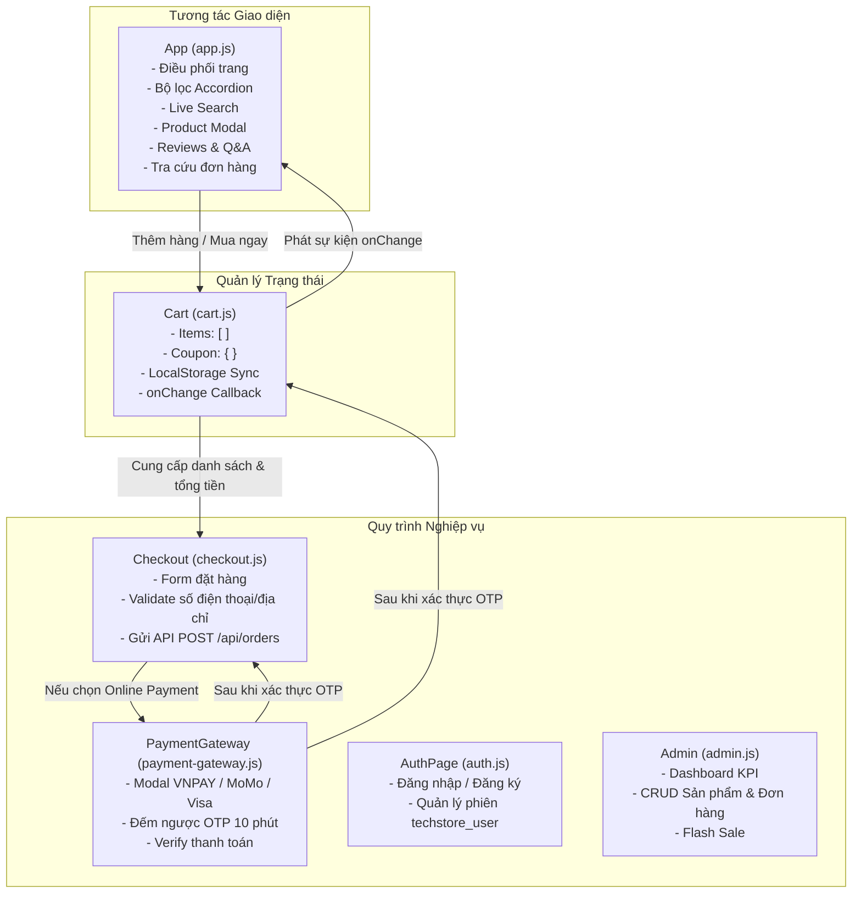
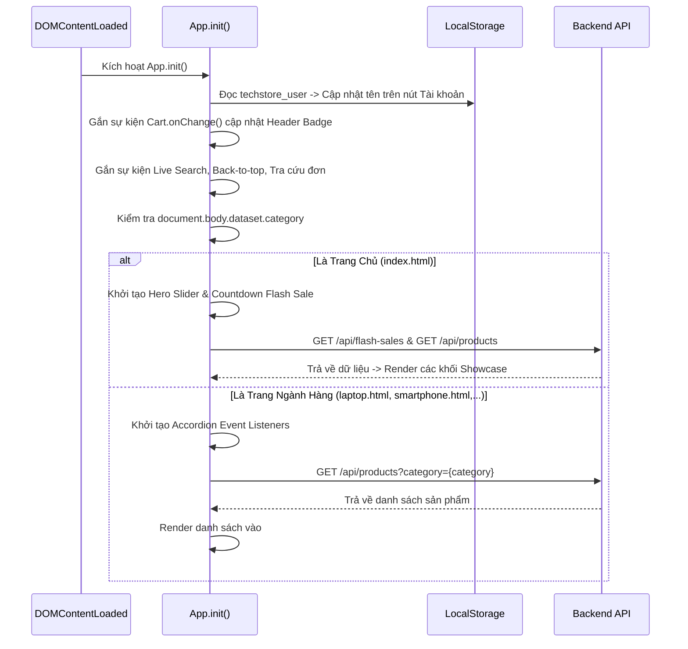

# Hướng Dẫn Kiến Trúc JavaScript Dự Án TechStore

> **Dự án**: TechStore - Website Bán Lẻ Công Nghệ  
> **Tài liệu tham chiếu**: [ARCHITECTURE.md](./ARCHITECTURE.md) | [DATA_FLOW.md](./DATA_FLOW.md) | [modules/README.md](./modules/README.md)

---

## 1. Triết Lý Thiết Kế JavaScript Phía Trình Duyệt

Thay vì sử dụng các framework cồng kềnh như React, Vue hay Angular vốn làm tăng dung lượng tải trang và độ phức tạp cấu hình, TechStore áp dụng kiến trúc **Vanilla ES6+ Singleton Pattern**. Mỗi chức năng lớn được đóng gói trong một đối tượng độc lập (Namespace Object), giúp:
- **Tránh ô nhiễm biến toàn cục**: Mọi thuộc tính và hàm đều được bao bọc bên trong các đối tượng như `App`, `Cart`, `Checkout`, `PaymentGateway`, `Admin`.
- **Dễ dàng gỡ lỗi (Debugging)**: Có thể truy cập và kiểm tra trạng thái của các service trực tiếp trong DevTools Console (ví dụ: gõ `Cart.getSummary()` hoặc `App.products`).
- **Khả năng phản ứng (Reactive State)**: Áp dụng mô hình Observer/Pub-Sub gọn nhẹ giúp UI tự động đồng bộ khi dữ liệu thay đổi.

---

## 2. Bản Đồ Các Module & Trách Nhiệm



---

## 3. Cơ Chế Reactive State & LocalStorage Của `Cart`

Mô hình giỏ hàng trong `public/js/cart.js` là trái tim của trải nghiệm mua sắm:

```javascript
// Minh họa cấu trúc đối tượng Cart (cart.js)
const Cart = {
  items: [],
  listeners: [],

  init() {
    this.loadFromStorage();
  },

  onChange(callback) {
    if (typeof callback === 'function') {
      this.listeners.push(callback);
    }
  },

  notify() {
    this.saveToStorage();
    this.listeners.forEach(cb => cb(this.getSummary()));
  },

  addItem(product, variant, quantity = 1) {
    // Logic kiểm tra trùng cart_key, tăng số lượng hoặc thêm mới
    this.notify(); // Tự động phát thông báo tới tất cả UI lắng nghe
  }
};
```

### Lợi Ích Của Cơ Chế Này:
1. **Độc lập giao diện**: Hàm `Cart.addItem()` không cần quan tâm giao diện hiển thị thế nào.
2. **Đồng bộ đa thành phần**: Cả Badge số lượng trên thanh Header, danh sách sản phẩm trong Drawer trượt, và bảng tóm tắt chi phí trong Modal Thanh toán đều tự động cập nhật ngay khi `notify()` được gọi.
3. **Lưu trữ bền vững**: Dữ liệu giỏ hàng được tự động lưu vào khóa `techstore_cart_v1` trong `localStorage`, không bị mất khi F5 hoặc chuyển trang.

---

## 4. Vòng Đời Khởi Tạo Giao Diện (`App.init()`)

Khi trình duyệt tải xong cây DOM (`DOMContentLoaded`), module `App` trong `public/js/app.js` bắt đầu chu kỳ khởi tạo:



---

## 5. Kỹ Thuật Event Delegation (Ủy Quyền Sự Kiện)

Do các thẻ sản phẩm (`.product-card`), nút tăng giảm số lượng trong giỏ, và danh sách đánh giá đều được sinh động từ dữ liệu API (Dynamic DOM), việc gắn `addEventListener` trực tiếp vào từng phần tử sẽ làm tốn bộ nhớ và mất sự kiện khi render lại.

TechStore áp dụng kỹ thuật **Event Delegation** trên các phần tử cha cố định:

```javascript
// Ví dụ lắng nghe click mở Modal chi tiết trên container cha
document.getElementById('product-grid')?.addEventListener('click', (e) => {
  const card = e.target.closest('.product-card');
  const buyBtn = e.target.closest('.btn-buy-now');
  const addCartBtn = e.target.closest('.btn-add-cart');

  if (addCartBtn) {
    e.stopPropagation();
    const productId = addCartBtn.dataset.id;
    App.handleAddToCart(productId);
    return;
  }

  if (card && !buyBtn) {
    const productId = card.dataset.id;
    App.openProductModal(productId);
  }
});
```

---

## 6. Xử Lý Bất Đồng Bộ & Thông Báo Người Dùng (Toast Notification)

Tất cả các giao tiếp mạng HTTP đều sử dụng cú pháp chuẩn `async/await` kết hợp với khối `try...catch` an toàn:
- Khi có lỗi mạng hoặc mã trạng thái HTTP `>= 400`, hệ thống không để ứng dụng bị đứng mà bắt lỗi và hiển thị thông báo thân thiện.
- Hàm tiện ích `App.showToast(message, type = 'info')` hiển thị thanh thông báo nổi ở góc trên bên phải màn hình (tự động biến mất sau 3 giây).

---

## 7. Danh Mục Tài Liệu Chi Tiết Từng Module

Để tìm hiểu chi tiết các hàm, tham số, giá trị trả về và luồng xử lý của từng file JavaScript, vui lòng xem các tài liệu chuyên biệt trong thư mục `docs/modules/`:

- [Tài liệu Module app.js](./modules/app.md): Phân tích toàn diện 2.530 dòng code điều khiển giao diện.
- [Tài liệu Module cart.js](./modules/cart.md): Phân tích chi tiết service giỏ hàng Reactive.
- [Tài liệu Module checkout.js](./modules/checkout.md): Phân tích luồng tạo đơn hàng và kiểm tra form.
- [Tài liệu Module payment-gateway.js](./modules/payment-gateway.md): Phân tích mô phỏng cổng thanh toán và xác thực OTP.
- [Tài liệu Module auth.js](./modules/auth.md): Phân tích luồng đăng nhập, đăng ký và đồng bộ phiên.
- [Tài liệu Module admin.js](./modules/admin.md): Phân tích logic bảng điều khiển quản trị viên.
